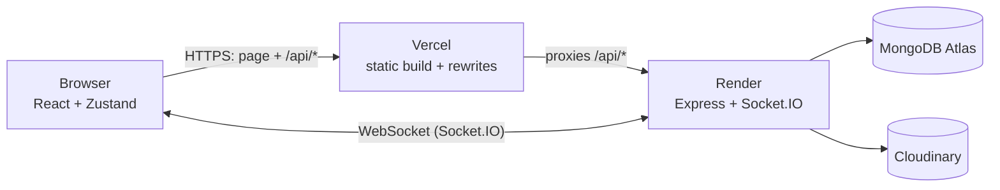

<div align="center">


# PeerConnect

**A real-time one-to-one messaging platform built with the MERN stack and Socket.IO.**

React 19 · Vite · Tailwind CSS v4 · daisyUI 5 · Zustand · Node.js · Express 5 · MongoDB Atlas · Socket.IO · Cloudinary

</div>

---

## Table of contents

1. [Features](#features)
2. [Architecture](#architecture)
3. [Project structure](#project-structure)
4. [Prerequisites](#prerequisites)
5. [Step 1: MongoDB Atlas](#step-1--mongodb-atlas)
6. [Step 2: Cloudinary (images & files)](#step-2--cloudinary-images--files)
7. [Step 3: Run locally](#step-3--run-locally)
8. [Step 4: Try it with two users](#step-4--try-it-with-two-users)
9. [Step 5: Test the API](#step-5--test-the-api)
10. [Step 6: Push to GitHub](#step-6--push-to-github)
11. [Step 7: Deploy the backend on Render](#step-7--deploy-the-backend-on-render)
12. [Step 8: Deploy the frontend on Vercel](#step-8--deploy-the-frontend-on-vercel)
13. [Step 9: Connect them and verify](#step-9--connect-them-and-verify)
14. [Environment variables](#environment-variables)
15. [REST API](#rest-api)
16. [Socket.IO events](#socketio-events)
17. [How it works](#how-it-works)
18. [Scaling to multiple servers](#scaling-to-multiple-servers)
19. [Known limitations](#known-limitations)
20. [Troubleshooting](#troubleshooting)

---

## Features

**Messaging**
- One-to-one real-time chat: messages appear instantly for the receiver and in the sender's other tabs
- Messages are saved to MongoDB **before** they're pushed, so offline users get them when they return
- Optimistic sending: your bubble appears immediately, with **Retry / Discard** if it fails
- Duplicate-safe: each message carries a client-generated id, so retries never create copies
- Delivery & read receipts: ✓ sent · ✓✓ delivered · ✓✓ (accent colour) read
- Typing indicators (rate-limited, auto-clear after 5 s or when the typist disconnects)
- Image and file sharing (PDF, Office documents, text, CSV, zip; max 3 MB). Images are resized in the browser before upload
- Infinite scroll for older messages (cursor pagination), date dividers, grouped bubbles, a "New messages" jump button
- Catch-up after reconnecting: anything missed while offline is fetched automatically

**Presence & contacts**
- Live online/offline status in the contact list and chat header, with "last seen"
- Correct across **multiple tabs and devices**: closing one tab doesn't mark you offline
- Contact list sorted by recent activity, with last-message preview, unread badges, search and a "show online only" filter
- New sign-ups and profile changes appear for everyone instantly

**Accounts & security**
- Sign up, log in, log out, session restore on refresh, profile name & picture
- bcrypt password hashing, JWT in an **httpOnly, SameSite** cookie
- Socket.IO handshake authenticated with a short-lived signed token, so a client can never claim to be another user
- Request validation with zod (also blocks NoSQL operator injection and unknown fields)
- Rate limiting on sign-up and login, helmet security headers, CORS allowlist, generic login errors

**Design**
- Original "Ember on Ink" design system: dark & light themes, 5 accent colours, all saved per device with no flash on load
- Landing, sign-up, login, chat, profile, settings and 404 pages
- Responsive: side-by-side on desktop; on mobile, the URL switches between the list and the chat, with a slide transition and working back button
- Skeleton loaders, empty states, error states, toasts, reconnecting banner, unread count in the tab title
- Keyboard: Enter to send, Shift+Enter for a new line, Esc to close a chat; visible focus rings; screen-reader labels

**Engineering**
- Modular backend (routes → controllers → services, socket handlers, validators, middleware)
- Centralised error handling with one JSON error shape, structured logging (pino), graceful shutdown
- Swagger / OpenAPI docs at `/api/docs`
- Automated tests: auth, messaging, pagination, receipts, presence, and Socket.IO integration (multi-tab, delivery, typing)

## Architecture



- **Why two hosts?** Vercel runs backend code as short-lived serverless functions, which can't hold the long-lived connections Socket.IO needs. Render runs a normal always-on Node.js server.
- **Why does `/api` go through Vercel?** The browser then only talks to your Vercel domain, so the login cookie is *first-party* and works in Safari/iOS, which block cross-site cookies.
- **Why does the socket connect straight to Render?** Vercel can't proxy WebSockets. Because the cookie isn't sent there, the app first asks `/api/auth/socket-token` (through Vercel, with the cookie) for a **2-minute signed token** and presents it in the Socket.IO handshake. The server verifies it and decides who the user is.
- **Locally**, Vite's dev server proxies both `/api` and `/socket.io` to `localhost:5001`, so development behaves like production.

## Project structure

```
peerconnect/
├── backend/                         → deployed to Render
│   ├── src/
│   │   ├── config/                  env validation, MongoDB, Cloudinary, CORS
│   │   ├── controllers/             thin HTTP handlers
│   │   ├── docs/openapi.js          Swagger spec (/api/docs)
│   │   ├── middleware/              protectRoute, validate, rate limits, errors
│   │   ├── models/                  User, Message (+ indexes)
│   │   ├── routes/                  /api/auth, /api/messages, /api/health
│   │   ├── services/                business logic (auth, messages, receipts)
│   │   ├── socket/                  Socket.IO setup, events, presence store, handlers
│   │   ├── utils/                   JWT, cookies, logger, errors, data URIs
│   │   ├── validators/              zod schemas
│   │   ├── app.js                   Express app (imported by tests)
│   │   └── server.js                HTTP + Socket.IO server
│   ├── tests/                       Vitest + Supertest + in-memory MongoDB
│   ├── postman/                     Postman collection
│   ├── requests.http                VS Code REST Client requests
│   └── .env.example
├── frontend/                        → deployed to Vercel
│   ├── src/
│   │   ├── components/              ui/ (design system), chat/, brand/
│   │   ├── constants/               socket event names, themes
│   │   ├── hooks/                   useMediaQuery
│   │   ├── layouts/                 AppLayout (nav rail), AuthLayout
│   │   ├── lib/                     axios instance, socket factory
│   │   ├── pages/                   Landing, Login, Signup, Chat, Profile, Settings, 404
│   │   ├── routes/                  route guards
│   │   ├── services/                REST calls
│   │   ├── stores/                  authStore, chatStore, themeStore (Zustand)
│   │   ├── styles/index.css         design tokens + daisyUI themes
│   │   └── utils/                   formatting, file helpers
│   ├── vercel.json                  /api proxy + SPA fallback
│   ├── vite.config.js               dev proxy
│   └── .env.example
└── README.md
```

## Prerequisites

| Tool / account | Why | Link |
|---|---|---|
| **Node.js 20+** (22 LTS recommended) | Runs both apps | https://nodejs.org |
| **Git** | Version control | https://git-scm.com |
| **GitHub** account | Hosts the code; Render & Vercel deploy from it | https://github.com |
| **MongoDB Atlas** account (free) | Database | https://www.mongodb.com/cloud/atlas/register |
| **Cloudinary** account (free, optional) | Profile pictures & attachments | https://cloudinary.com/users/register_free |
| **Render** account (free) | Backend hosting | https://render.com |
| **Vercel** account (free) | Frontend hosting | https://vercel.com |

Tip: sign up to Render and Vercel **with GitHub** so connecting the repo is one click.

---

## Step 1: MongoDB Atlas

### 1.1 Create a free cluster
1. Sign in at **https://cloud.mongodb.com** and create a project (e.g. `PeerConnect`).
2. Click **Create** → choose **Free (M0)**.
3. Pick a region near where you'll host the backend. *In India: AWS **Mumbai (ap-south-1)** or **Singapore (ap-southeast-1)**, then choose Render's **Singapore** region.*
4. Click **Create Deployment**.

### 1.2 Create a database user
**Security → Database Access → Add New Database User**
1. Method: **Password**. Username e.g. `peerconnect_app`.
2. **Autogenerate Secure Password** → copy it somewhere safe.
3. Role: **Read and write to any database** → **Add User**.

> This is a *database* user, not your Atlas login. If you type your own password and it contains
> `@ : / ? # [ ] %`, URL-encode those characters in the connection string (`@` → `%40`).

### 1.3 Allow network access
**Security → Network Access → Add IP Address**

| Backend runs on | Add |
|---|---|
| Your computer | **Add Current IP Address** (re-add if your ISP changes your IP) |
| Render | **Allow Access from Anywhere** → `0.0.0.0/0` (Render's free tier has no fixed IP) |

### 1.4 Copy the connection string
**Database → Connect → Drivers → Node.js** → copy:
```
mongodb+srv://peerconnect_app:<db_password>@cluster0.xxxxx.mongodb.net/?retryWrites=true&w=majority&appName=Cluster0
```
Replace `<db_password>` (including the `< >`) with your password. You don't need to add a database name: the app uses `MONGODB_DB_NAME` (default `peerconnect`). Collections appear under **Browse Collections** after the first sign-up.

---

## Step 2: Cloudinary (images & files)

Optional: without it everything works except profile pictures and attachments (the app shows a clear message instead).

1. Create a free account at **https://cloudinary.com/users/register_free**.
2. Open the **Dashboard** (or **Settings → API Keys**) and copy:
   - **Cloud name**
   - **API Key**
   - **API Secret** (click to reveal)
3. **Allow PDF/zip delivery:** new accounts block delivery of PDF and ZIP files by default. Go to **Settings → Security** and enable **"Allow delivery of PDF and ZIP files"**, otherwise shared PDFs/zips will upload but fail to open.

Uploaded files go into the folders `peerconnect/avatars` and `peerconnect/attachments` in your Media Library.

---

## Step 3: Run locally

You need **two terminals running at the same time**: one for the backend, one for the frontend.

### 3.1 Backend (terminal 1)
```bash
cd backend
npm install
cp .env.example .env          # Windows PowerShell: Copy-Item .env.example .env
```
Edit `backend/.env`:
- `MONGODB_URI` → your Atlas string from step 1.4
- `JWT_SECRET` → a long random string. Generate one:
  ```bash
  node -e "console.log(require('crypto').randomBytes(48).toString('hex'))"
  ```
- `CLOUDINARY_*` → the three values from step 2 (or leave empty)

Start it with **nodemon** (auto-restarts when you save a file):
```bash
npm run dev
```
You should see `MongoDB connected` and `PeerConnect API listening on http://localhost:5001`. **Leave this terminal running.**

### 3.2 Frontend (terminal 2)
Open a new terminal tab (macOS: <kbd>⌘</kbd> + <kbd>T</kbd>; VS Code: the **+** in the terminal panel):
```bash
cd frontend
npm install
npm run dev
```
Open **http://localhost:5173**. No frontend `.env` is needed locally.

---

## Step 4: Try it with two users

Real-time features need two people. Use two separate browser sessions so they have separate cookies:

1. **Window A** (normal browser window): http://localhost:5173 → **Get started** → create *User A*.
2. **Window B** (an **incognito/private** window, or a different browser): create *User B*. User A sees B appear in the contact list immediately, with a green online dot.
3. In A, click User B and send a message. It appears in B instantly.
4. Watch the ticks in A: ✓ sent → ✓✓ delivered → ✓✓ in accent colour when B opens the chat.
5. Type in B and A sees "typing…".
6. Close window B. A sees B go offline with "Last seen just now".
7. Send B a message while B is offline, then log B in again: the message is there, and A's tick turns to delivered.
8. Open a second tab as User A: messages sync across both tabs, and closing one tab keeps A online.
9. Try the mobile layout: browser DevTools → device toolbar (iPhone/Pixel).

---

## Step 5: Test the API

**Swagger docs:** with the backend running, open **http://localhost:5001/api/docs**. Use *Try it out* on `POST /api/auth/login`, then the protected routes work in the same page.

**Postman:** Import `backend/postman/PeerConnect.postman_collection.json` → run **Auth → Sign up**, then **Messages → Contacts** (saves the first contact's id) → **Send message**. Each request has tests in the *Test Results* tab.

**VS Code REST Client / Thunder Client:** open `backend/requests.http` and click **Send Request** above any block.

**Automated tests** (no Atlas needed; they use an in-memory MongoDB):
```bash
cd backend
npm test
```
The first run downloads a MongoDB binary (~100 MB), so it takes a minute. The suites cover:
- **auth:** signup, login, validation, injection, session, logout, socket token, profile
- **messages:** send, idempotency, invalid payloads, history, pagination, privacy, contacts, receipts
- **socket:** handshake auth, multi-tab presence, real-time delivery, delivered/read receipts, typing
- **presence:** the presence store logic
- **app:** health, security headers, CORS, JSON errors

---

## Step 6: Push to GitHub

1. On GitHub: **New repository** → `peerconnect` → leave *Add a README* **unchecked** → **Create**.
2. From the project root (the folder containing `backend/` and `frontend/`):
   ```bash
   git init
   git add .
   git status                 # make sure NO .env file is listed
   git commit -m "PeerConnect: real-time messaging app"
   git branch -M main
   git remote add origin https://github.com/<your-username>/peerconnect.git
   git push -u origin main
   ```
Commit both `package-lock.json` files; Render uses them.

---

## Step 7: Deploy the backend on Render

1. **https://dashboard.rend er.com** → **New** → **Web Service** → select your `peerconnect` repo.
2. Settings:

   | Setting | Value |
   |---|---|
   | Name | `peerconnect-api` (becomes `https://peerconnect-api.onrender.com`) |
   | Region | Near your Atlas cluster (e.g. **Singapore**) |
   | Branch | `main` |
   | **Root Directory** | `backend` |
   | Runtime | Node |
   | **Build Command** | `npm ci` |
   | **Start Command** | `npm start` |
   | Instance Type | Free |

3. **Environment Variables:**

   | Key | Value |
   |---|---|
   | `NODE_ENV` | `production` |
   | `MONGODB_URI` | your Atlas connection string |
   | `MONGODB_DB_NAME` | `peerconnect` |
   | `JWT_SECRET` | a **new** random string (don't reuse your local one) |
   | `CLIENT_URLS` | `http://localhost:5173` for now; updated in step 9 |
   | `TRUST_PROXY` | `2` (requests pass through Vercel and then Render's proxy) |
   | `CLOUDINARY_CLOUD_NAME` / `CLOUDINARY_API_KEY` / `CLOUDINARY_API_SECRET` | from step 2 (optional) |

   Don't add `PORT`; Render sets it.
4. **Advanced → Health Check Path:** `/api/health`
5. **Create Web Service**. Wait for `MongoDB connected` in **Logs**, then open `https://<your-service>.onrender.com/api/health`.

---

## Step 8: Deploy the frontend on Vercel

### 8.1 Point the `/api` proxy at Render
In `frontend/vercel.json`, replace `YOUR-RENDER-SERVICE` with your Render service name:
```json
"destination": "https://peerconnect-api.onrender.com/api/:path*"
```
```bash
git add frontend/vercel.json
git commit -m "Point Vercel /api proxy to Render"
git push
```

### 8.2 Import the project
1. **https://vercel.com/new** → import the `peerconnect` repo.
2. Settings:

   | Setting | Value |
   |---|---|
   | Framework Preset | **Vite** |
   | **Root Directory** | `frontend` |
   | Build / Output | defaults (`npm run build`, `dist`) |

3. **Environment Variables:**

   | Key | Value |
   |---|---|
   | `VITE_SOCKET_URL` | `https://peerconnect-api.onrender.com` (your Render URL, no trailing slash) |

4. **Deploy**. You'll get a URL like `https://peerconnect-yourname.vercel.app`.

> If you change `VITE_SOCKET_URL` later, **redeploy** on Vercel. `VITE_` variables are baked in at build time.

---

## Step 9: Connect them and verify

1. **Render → peerconnect-api → Environment:** set `CLIENT_URLS` to your Vercel URL. Several are comma-separated, e.g.
   `https://peerconnect-yourname.vercel.app,http://localhost:5173`
   This allowlist is what lets the browser open a Socket.IO connection to Render. Saving redeploys.
2. Checklist:
   - [ ] `https://<render>.onrender.com/api/health` → `"database": "connected"`
   - [ ] `https://<vercel-app>/api/health` → same JSON (the Vercel proxy works)
   - [ ] Sign up on the Vercel URL, then refresh: you stay logged in (cookie works)
   - [ ] Repeat [Step 4](#step-4--try-it-with-two-users) on the live site with two browsers
   - [ ] Refresh on `/settings` or `/chat/<id>`: the page loads (SPA fallback works)

**Render free tier sleeps** after ~15 min without traffic, and the first request then takes 30–60 s (the app shows "Waking up the server…"). For demos, add a free monitor at **https://uptimerobot.com** that hits `https://<render>.onrender.com/api/health` every 5 minutes.

---

## Environment variables

### Backend (`backend/.env` locally, Render dashboard in production)

| Variable | Required | Default | Description |
|---|---|---|---|
| `NODE_ENV` | no | `development` | `production` on Render |
| `PORT` | no | `5001` | Set automatically by Render |
| `MONGODB_URI` | **yes** | none | Atlas connection string |
| `MONGODB_DB_NAME` | no | `peerconnect` | Database name |
| `JWT_SECRET` | **yes** | none | ≥ 32 random characters. Changing it logs everyone out |
| `CLIENT_URLS` | no | `http://localhost:5173` | Comma-separated allowed frontend origins (CORS + Socket.IO) |
| `TRUST_PROXY` | no | `1` | Proxy hops in front of the app: `1` locally, `2` on Render behind Vercel |
| `LOG_LEVEL` | no | `info` | `debug` for more detail |
| `CLOUDINARY_CLOUD_NAME` | no | none | Enables uploads (all three required) |
| `CLOUDINARY_API_KEY` | no | none | |
| `CLOUDINARY_API_SECRET` | no | none | |

### Frontend (`frontend/.env` locally, Vercel dashboard in production)

| Variable | Default | Description |
|---|---|---|
| `VITE_SOCKET_URL` | *(empty = same origin)* | Leave empty locally. On Vercel: your Render URL |
| `VITE_DEV_API_TARGET` | `http://localhost:5001` | Where Vite's dev proxy sends `/api` and `/socket.io` |

Everything starting with `VITE_` is public (it's in the browser bundle). Never put secrets there.

---

## REST API

Interactive docs: **`/api/docs`**. All responses are `{ success: true, data }` or `{ success: false, error: { code, message, details? } }`.

| Method | Endpoint | Auth | Description |
|---|---|---|---|
| GET | `/api/health` | none | Liveness + database state |
| POST | `/api/auth/signup` | none | Create account, set cookie (rate-limited) |
| POST | `/api/auth/login` | none | Log in, set cookie (rate-limited) |
| POST | `/api/auth/logout` | none | Clear cookie |
| GET | `/api/auth/check` | cookie | Current user (session restore) |
| GET | `/api/auth/socket-token` | cookie | 2-minute token for the Socket.IO handshake |
| PUT | `/api/auth/update-profile` | cookie | `{ fullName?, profilePic? (data URI) }` |
| GET | `/api/messages/users` | cookie | Contacts with `lastMessage` and `unreadCount` |
| GET | `/api/messages/:id?before=&after=&limit=` | cookie | History with a user, oldest → newest, cursor-paginated |
| POST | `/api/messages/send/:id` | cookie | `{ text?, clientMessageId (uuid), attachment?: { dataUri, name } }` → 201 (or 200 for a retry) |

## Socket.IO events

| Event | Direction | Payload | Purpose |
|---|---|---|---|
| `getOnlineUsers` | server → all | `string[]` | Online user ids (sent when someone goes online/offline) |
| `newMessage` | server → receiver & sender rooms | message | Real-time delivery + sync across the sender's tabs |
| `typing` / `stopTyping` | client → server → peer | `{ to }` / `{ from }` | Typing indicator |
| `messageDelivered` | client → server (ack) | `{ messageIds }` | Receiver's app got the message |
| `messageRead` | client → server (ack) | `{ peerId }` | Receiver opened the chat |
| `messageStatus` | server → sender | `{ ids, status, at }` | Updates ticks |
| `conversationRead` | server → reader's tabs | `{ peerId }` | Clears unread badges in other tabs |
| `userJoined` / `userUpdated` | server → all | public user | New sign-up / profile change |

Every socket joins a room named `user:<id>`, so emitting to that room reaches all of a user's tabs and devices.

---

## How it works

**Sending a message**
1. The browser shows the message immediately (status *sending*) and calls `POST /api/messages/send/:id` with a random `clientMessageId`.
2. `protectRoute` verifies the cookie JWT; zod validates the body.
3. If a message with that `clientMessageId` already exists (a retry), it's returned as-is, so it's never duplicated.
4. Any attachment is checked (type and size, on the server) and uploaded to Cloudinary.
5. The message is **saved to MongoDB first**, then emitted as `newMessage` to the receiver's room and the sender's room.
6. The receiver's app acknowledges with `messageDelivered`; opening the chat sends `messageRead`. The sender sees the ticks update via `messageStatus`.
7. If the receiver is offline, nothing is lost: the message is in MongoDB, and when they connect the server marks pending messages delivered.

**Presence:** the server keeps `Map<userId, Set<socketId>>`. A user is online while the set is non-empty; `getOnlineUsers` is broadcast only when a user's first socket connects or last socket disconnects. On the last disconnect `lastSeen` is saved.

**Listener hygiene:** each socket event handler is registered **once per connection** (`off` then `on`) in the chat store. Handlers read the currently open chat from the store at the moment a message arrives, so switching chats never stacks listeners or causes duplicate messages.

**Reconnects:** Socket.IO reconnects automatically, fetching a fresh socket token each time. After reconnecting the app refetches contacts and any messages newer than the last one it has. If the server rejects the handshake, the app re-checks the session and either retries or logs out cleanly.

**Database indexes**
- `Message { conversationKey, createdAt, _id }`: history and pagination in one range scan (`conversationKey` = the two user ids, sorted)
- `Message { receiverId, status }`: pending deliveries and unread counts
- `Message { senderId, clientMessageId }` **unique**: idempotent sends
- `User { email }` **unique**

## Scaling to multiple servers

This deployment runs **one** Node.js instance, and presence lives in that process's memory. To run several instances:
1. Add Redis (e.g. Render Key Value or Upstash).
2. Use `@socket.io/redis-adapter` so `io.to(room).emit()` reaches sockets on every instance via Redis Pub/Sub.
3. Replace `MemoryPresenceStore` with a Redis-backed store implementing the same async interface (`add`, `remove`, `isOnline`, `onlineUserIds`). `initSocket(server, { presence })` already accepts one.
4. Enable sticky sessions on the load balancer (needed for Socket.IO's HTTP long-polling fallback).

Nothing beyond step 3's interface is implemented yet.

## Known limitations

- **Group chats are not implemented.** The `conversationKey` design is the stepping stone (it becomes a `conversationId` with a `Conversation` model).
- Single-instance presence (see above).
- Attachments are limited to 3 MB (Vercel's proxy caps request bodies around 4.5 MB).
- No end-to-end encryption; messages are protected in transit (HTTPS/WSS) and by access control.
- Read receipts are sent over the socket; if the socket is down when a chat is opened, they're sent the next time that chat is opened while connected.

---

## Troubleshooting

<details>
<summary><b><code>[vite] http proxy error … ECONNREFUSED</code></b></summary>

The backend isn't running. Keep `npm run dev` running in `backend/` in its own terminal while the frontend runs in another.
</details>

<details>
<summary><b>"❌ Invalid environment configuration"</b></summary>

Copy `.env.example` to `.env` and fill in the listed variables. Since v1.0 `JWT_SECRET` (≥ 32 chars) is required.
</details>

<details>
<summary><b><code>bad auth : authentication failed</code></b></summary>

Wrong database user or password. Reset it in Atlas → Database Access, remove the `< >` brackets, URL-encode special characters.
</details>

<details>
<summary><b><code>Could not connect to any servers</code> / IP not whitelisted</b></summary>

Atlas → Network Access: add your current IP (local) or `0.0.0.0/0` (Render). Wait a minute.
</details>

<details>
<summary><b><code>querySrv ENOTFOUND</code> / <code>ETIMEOUT</code></b></summary>

Your network blocks the SRV DNS lookup (common on college/office Wi-Fi). Try a mobile hotspot or set DNS to `8.8.8.8`.
</details>

<details>
<summary><b>Messages only show after refresh in production / "Connection lost. Reconnecting…" never clears</b></summary>

The socket can't reach Render. Check:
1. Vercel has `VITE_SOCKET_URL=https://<render>.onrender.com` **and you redeployed** after setting it.
2. Render's `CLIENT_URLS` contains your exact Vercel URL (https, no trailing slash).
3. Browser DevTools → Network → WS shows the connection; Console shows any CORS error.
</details>

<details>
<summary><b>Logged out right after logging in on the live site</b></summary>

The cookie isn't sticking. Make sure you're calling the API through the Vercel URL (`/api/...`), not the Render URL directly, and that `vercel.json` points to the right Render service.
</details>

<details>
<summary><b>"File uploads are not configured on this server"</b></summary>

Set all three `CLOUDINARY_*` variables (in `.env` locally or on Render) and restart/redeploy.
</details>

<details>
<summary><b>Shared PDFs/zips fail to open</b></summary>

Cloudinary → Settings → Security → enable **Allow delivery of PDF and ZIP files**.
</details>

<details>
<summary><b>Render deploy fails at <code>npm ci</code></b></summary>

Commit `backend/package-lock.json` (created by `npm install`) and push.
</details>

<details>
<summary><b>Render: "No open ports detected"</b></summary>

The server exited before listening, almost always a MongoDB problem. Look for the `Hint:` line in Render's Logs.
</details>

<details>
<summary><b>"Too many attempts" when logging in</b></summary>

10 failed logins per 15 minutes per IP + email are allowed. Wait, or restart the backend locally to reset the counter.
</details>

<details>
<summary><b><code>npm test</code> hangs on first run</b></summary>

It's downloading the MongoDB binary for the in-memory database. Give it a few minutes on a slow connection.
</details>
